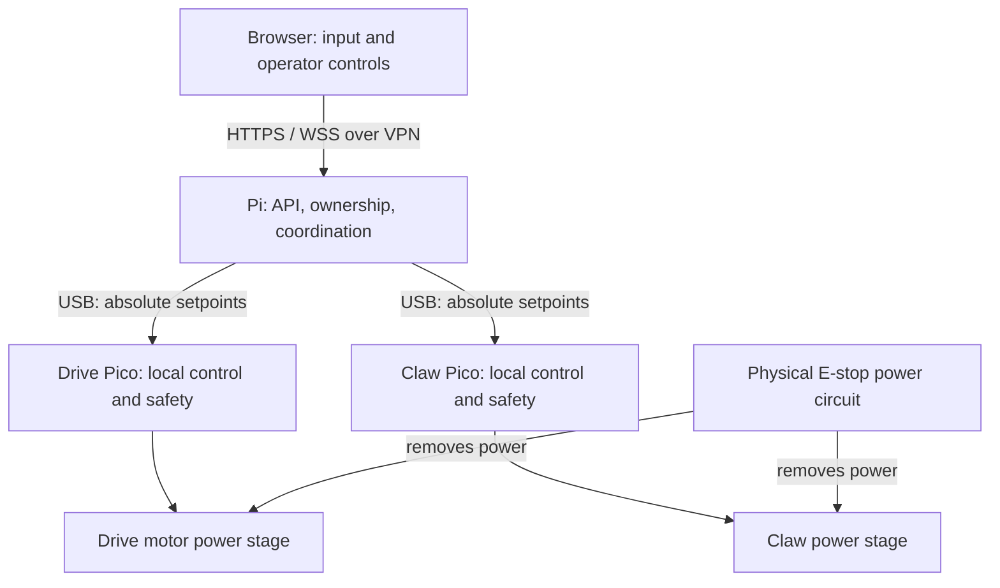

# Modular Robot Software Design

Oct 20, 2026 · @bryan · Revised scaffolding specification

## 1. Purpose and status

A Raspberry Pi coordinates self-contained Raspberry Pi Pico modules for a differential-drive base and a claw. The Pi handles internet access, operator ownership, and coordination. Each Pico owns its sensors, actuator control, hard limits, and local failure response.

This is the implementation brief for a single repository. Place it at `docs/DESIGN.md` and reference it from `CLAUDE.md`. It specifies intended behavior; it is not evidence that a particular motor, controller, or stopping distance has been validated.

**In scope:** repository layout, protocol, firmware and host responsibilities, operator control, failure behavior, tests, deployment, and maintenance. **Deferred:** autonomy, vision, video streaming, CAN, ROS 2, remote firmware updates, and arbitrary third-party plugins.

Requirements using **must** are acceptance conditions. Defaults are concrete v1 implementation choices. Items marked **hardware gate** require actual hardware information before powered operation. Do not invent pins, gains, sensor calibration, safe holding effort, or stopping distances to fill those gaps.

The revision preserves the original architecture while making freshness, arming, recovery, serialization, build ownership, and change procedures explicit. It selects a smaller supported baseline rather than promising every hardware and transport combination.

### Glossary

| Term | Meaning |
| --- | --- |
| Pi | Raspberry Pi Linux host/coordinator |
| Pico | Module microcontroller; v1 targets Raspberry Pi Pico with RP2040 |
| Module | A physical subsystem, its firmware, and its host driver |
| HAL | Board-facing sensor and actuator abstraction |
| Platform | SDK-facing timing, synchronization, watchdog, identity, and link implementation |
| PIO / PWM / PID | Programmable I/O / pulse-width modulation / proportional-integral-derivative control |
| COBS / CRC | Byte-stream framing / corruption detection |
| CDC-ACM | USB serial class used for the Pi–Pico link |
| Session | One accepted connection identity; old-session commands are rejected |
| Freshness ticket | Receiver-issued value with a deadline on the receiver's monotonic clock |
| Arm | Explicitly permit actuator control after safety checks |
| Software stop | A latched command to disable outputs; distinct from the physical E-stop |
| Physical E-stop | Hardware circuit that removes actuator power independently of software |
| UF2 | Firmware image format used for Pico flashing |
| ADR | Architecture decision record: context, decision, consequences, migration |

## 2. Architecture and supported baseline



Telemetry returns over the same links. The E-stop power path does not depend on the Pi, Pico, USB, or internet. An auxiliary E-stop/power-status input is also required on each Pico to latch a restart interlock; this input supplements the independent power cut.

| Layer | Default rate | Timing contract |
| --- | --- | --- |
| Browser input sampling and command emission | 30 Hz | Best effort; no safety reliance on final browser message |
| Pi control tick | 50 Hz | Monotonic deadlines; missed ticks skipped, never replayed in a burst |
| Drive control | 500 Hz | 2 ms period; bounded execution and jitter measured on hardware |
| Claw control | 200 Hz | 5 ms period; bounded execution and jitter measured on hardware |
| PWM, encoder capture, ADC sampling | Hardware-specific | Profile defines peripherals, rates, synchronization, and calibration |

These are separate timing domains, not an assumed 10× hierarchy. Linux and the internet do not provide hard real-time guarantees.

### Concrete v1 choices

| Area | Selected baseline |
| --- | --- |
| Pi | Raspberry Pi 4, Ubuntu Server 24.04 LTS arm64; Pi 5 support requires its own deployment validation |
| Pico | RP2040 Raspberry Pi Pico, `PICO_BOARD=pico`; Pico 2/RP2350 is a later tested board target |
| Firmware | C11, Pico SDK 2.2.0, Arm GNU Toolchain 13.2.Rel1, CMake/Ninja |
| Host | Python 3.12, asyncio, aiohttp, Pydantic 2, pyserial-asyncio |
| Web | TypeScript, Vite, no UI framework; Node.js 22 build environment |
| Operator protocol | Versioned JSON over WSS; MessagePack is not implemented in v1 |
| Access | Tailscale VPN, authenticated application sessions, TLS terminated by aiohttp |
| Drive model | Differential drive: forward velocity and yaw rate only |
| Claw model | DC geared actuator with position feedback, current sensing, and end-limit switches; actual components remain a hardware gate |
| Tests | Unity for portable C; pytest/pytest-asyncio for Python; Vitest for browser logic |
| Packaging | Python wheel containing built web assets; separate UF2s and release manifest |

These are chosen compatibility targets, not claims that these are the newest releases. Milestone 1 must resolve and commit exact patch versions, tool archive checksums, SDK submodule commit, Python dependency locks, npm lockfile, and a CI container digest in `tools/toolchain.lock.json`. No placeholder digest or floating `latest` tag may pass that milestone. The selected combination must build in CI before it is described as verified. Dependency updates are deliberate maintenance changes, not silently picked up during deployment.

A dummy hardware profile builds for compilation and simulation but cannot arm physical outputs. Real hardware requires a reviewed board profile. A basic hobby servo is a different claw implementation and cannot advertise sensed position or grip-force capability without the relevant external sensors.

## 3. Design decisions

| ID | Decision | Consequence and boundary |
| --- | --- | --- |
| D1 | One monorepo and release tag | Firmware, host, protocol, UI, and deployment change together; deployed compatibility is still checked |
| D2 | Local actuator control and hard limits on Picos | Pi coordinates; no internet or host scheduling dependency inside a control loop |
| D3 | One schema for wire messages | Generate explicit C/Python codecs and protocol reference; commit generated outputs and check freshness |
| D4 | USB first, packet transport abstraction | CAN later gets addressing and fragmentation design; no unused CAN implementation now |
| D5 | Absolute motion targets, session/sequence checks, bounded freshness | No motion deltas or toggles; administrative actions use explicit request/result semantics |
| D6 | Independent local failure responses | Browser notification is best effort; host deadlines, Pico deadlines, watchdog, and physical E-stop remain distinct |
| D7 | Explicit module registry and identity enrollment | Small static registry; unknown/duplicate hardware stays unarmed |
| D8 | WSS JSON and bounded queues | Latest unsent intent wins; queued TCP bytes still require freshness rejection |
| D9 | VPN plus application authentication | No port forwarding or MQTT broker in v1 |
| D10 | C firmware, Python host, TypeScript UI | Small, typed interfaces; no unnecessary framework or generic plugin machinery |
| D11 | ROS 2 deferred | First integration should be a topic bridge; ros2_control may require command/interface changes |
| D12 | Typed runtime config plus compiled board profiles | Host tuning needs no rebuild; firmware calibration and hard limits do |

### Scope of future compatibility

- The current drive interface supports compatible differential/skid-steer behavior, not full holonomic motion. Mecanum lateral velocity requires a deliberate interface and telemetry extension.
- CAN is a future transport project. `can2040` supports classic CAN 2.0B on RP2040/RP2350; it does not supply CAN FD. A CAN design must cover identifiers, addressing, discovery, priorities, fragmentation, bounded reassembly, bus-off recovery, and hardware termination/power behavior. A packet size limit alone does not solve these.
- A custom fixed-layout codec is chosen for a small, readable contract. Nanopb supports static allocation; replacing the codec with it would be a protocol/dependency migration, not merely changing a generator.
- ROS 2 Lyrical is an LTS release supported through May 2031, with Ubuntu 26.04 arm64 among its Tier 1 platforms. ROS 2 does not universally require Ubuntu. The current Ubuntu 24.04 host baseline is independent of a future ROS distribution choice.
- A ROS bridge can map body-velocity commands and odometry without moving Pico loops. The standard ros2_control differential-drive controller emits wheel-joint velocity commands; adapting this body-velocity protocol to that interface requires a separate design.

## 4. Readability and maintainability rules

### 4.1 Prefer explicit code and narrow boundaries

1. Keep pure calculations and state transitions separate from hardware, transport, persistence, and UI code. Pass inputs and return outputs; inject a clock where time affects behavior.
2. Use small cohesive modules named for their responsibility. Avoid catch-all `utils.py`, a giant `main.py`, and generic base classes with optional methods for every conceivable module.
3. Use abstraction where there are real alternatives: physical/simulated transport, real/fake clock, and board hardware. Do not prebuild a plugin loader, dependency-injection framework, distributed message bus, or generic workflow engine.
4. Prefer straightforward functions and typed data objects. Firmware public APIs use explicit ownership, lifetimes, units, and error results. Python public interfaces have type annotations; TypeScript uses strict mode.
5. Comments explain invariants, units, timing assumptions, and reasons. Avoid comments that merely restate code. Every state transition needs a named event and guard, not scattered Boolean tests.
6. No silent fallback from invalid configuration, unknown hardware, unsupported capability, or malformed commands to motion. Fail startup or leave the affected module disarmed with a useful reason.
7. No speculative empty adapters. Add `can.py`, `ros2_ws/`, or a new module only when implementing and testing them.
8. Keep errors structured: stable reason code for logic plus a readable description for people. Logs must include module identity/session context, without credentials.

### 4.2 Single ownership of mutable state

- Core 0 owns actuator state, faults, arming, command acceptance, and deadlines. Core 1 parses bytes and transfers bounded messages; it never writes motor-control variables directly.
- The host control task owns operator lease state, accepted intent, shaping, and coordination state. API tasks submit validated events; they do not mutate driver state or send hardware packets.
- Each link task owns its transport, packet sequence, session, handshake, and pending request. UI and recorder consume immutable snapshots.
- Use a bounded event queue for administrative events and a one-item mailbox for replaceable operator intent. Validate authorization before replacing the mailbox. No unbounded pub/sub bus is required in v1.
- If a required queue is full, reject the request explicitly or trigger the defined safe response. Never silently drop a software-stop request behind telemetry.

### 4.3 Dependency rules

- `firmware/common/` is portable C with no Pico SDK headers. It contains codecs, framing, control math, safety state transitions, and protocol validation.
- Only `firmware/platform/` and `firmware/hal/` may call SDK hardware APIs. Platform owns timers, multicore synchronization, identity, watchdog, and USB; HAL owns sensors and actuators.
- Module logic depends on common code and HAL interfaces, never another module's implementation. `main.c` is composition only.
- `host/api/` submits events to `control/`; it never imports a transport implementation or calls a driver directly.
- `host/control/` uses module driver interfaces; drivers prepare typed commands but do not open ports.
- The link layer owns packet serialization. Serial transport owns COBS and CRC; simulation uses the same codecs and framing.
- Generated outputs are clearly marked and never hand-edited. Generation is deterministic and contains no wall-clock timestamp.
- Enforce import/include boundaries with lightweight automated checks. Avoid a new architecture framework solely to enforce them.

### 4.4 Changes and documentation

`docs/DESIGN.md` owns architecture and safety intent. `protocol/messages.yaml` owns byte layouts, message IDs, enums, field constraints, and wire-level constants. Board profiles own physical calibration and hard safety bounds. Runtime YAML owns operational limits below those bounds. Generated `docs/protocol.md` is a reference, not a second editable schema.

An ADR is required for changing a safety invariant, a transport/command contract, a dependency boundary, a supported platform, or a protocol compatibility policy. Ordinary internal refactors do not need an ADR. Each ADR records alternatives, compatibility impact, migration/rollback, and validation.

Adding a module should normally change: its firmware folder/profile, its host driver, the explicit registry, its schema messages/capabilities, tests, and operator presentation. It must not require edits to unrelated module implementations. It is acceptable to touch the registry and schema; avoiding those edits is not a design goal.

## 5. Safety, freshness, and recovery contract

### 5.1 Definitions and defaults

All decisions use monotonic clocks. Wall-clock timestamps are for human logs only. No cross-machine clock subtraction is used for safety.

| Setting | Default | Owner / meaning |
| --- | --- | --- |
| Host tick | 20 ms | Pi control scheduling |
| Operator ticket period / lifetime | 50 ms / 200 ms | Pi issues freshness tickets to the active operator |
| Operator silence timeout | 300 ms | Maximum silence since last fully accepted operator command; ticket expiry usually acts sooner |
| Pico setpoint transmit period | 20 ms | Host sends current absolute desired state |
| Pico ticket period / lifetime | 20 ms / 80 ms | Pico issues freshness tickets over USB |
| Setpoint TTL | 60 ms | Reception-relative lifetime, additionally capped by ticket expiry |
| Pico link timeout | 100 ms | No new valid in-session host traffic |
| Host heartbeat fallback | Every 20 ms without another outgoing frame | Connectivity only; never renews a setpoint |
| Serial write deadline | 20 ms | On timeout, close link, discard pending work, require handshake/rearm |
| Firmware hardware watchdog | 250 ms | Fed only after successful completion of a control iteration |
| Drive controlled-stop deadline | Hardware profile, maximum 250 ms | Disable outputs by deadline; mechanical stopping is measured separately |

The internet path is intended for connections whose round trip plus processing fits within the 200 ms ticket lifetime with margin. A 300 ms one-way path is not a supported v1 operating assumption. Excess latency leads to a safe response; increasing the lifetime requires a documented safety review and bench acceptance update.

### 5.2 Receiver-issued freshness tickets

Both links use the same small algorithm with different lifetimes:

1. The receiver issues a ticket ID and records its expiry on its own monotonic clock. Only actually issued, unexpired tickets for the current session are accepted.
2. The sender echoes a ticket in each newly constructed command. It must sample current input before sending; it must not attach a new ticket to an old queued command.
3. The receiver validates session, sequence, ticket, ownership/capabilities, and all numeric values before accepting the command.
4. The accepted command's effective deadline is the earliest applicable deadline: ticket expiry, local reception plus TTL, or operator lease deadline.
5. Neither a duplicate nor a rejected message updates a freshness deadline. A new sequence using an older still-valid ticket cannot extend the ticket's expiry.

Ticket IDs are nonzero u32 counters scoped to a session; start at 1. Rotate a disarmed session before wrap rather than reusing a ticket ID. Keep at most eight ticket records per receiver; discard expired ones first. At the specified periods this covers the live window. These tickets bound age without clock synchronization; they are not authentication and do not defend against an authorized host deliberately inventing motion.

The Pi may repeat the latest accepted operator intent on its 50 Hz module link only while that intent remains authorized by the original operator deadline. A new Pico ticket never extends upstream operator authority. The Pico publishes tickets in `LinkStatus`; the Pi publishes operator tickets on the control WebSocket. On a safety disarm, invalidate tickets and pending motion, then issue new tickets. An old command must not survive a restart/rearm boundary.

### 5.3 Host response and operator ownership

There is at most one operator lease. A viewer may see telemetry but cannot mutate control state. Claiming control while another lease is active returns a conflict; v1 has no forced remote takeover. Releasing control, disconnecting, expiration, or server restart revokes the lease, discards pending intent, cancels macros, and initiates the module-specific safe response. A returning client must claim again and explicitly arm.

A valid lease alone does not permit motion. Operator commands must also carry fresh tickets, increasing sequence numbers, and `enabled=true` from a held deadman control. `enabled=false`, release, tab hiding, loss of focus, or gamepad disconnect requests a safe disarm. Browser notification is best effort; receiver expiry remains authoritative.

The host stops producing motion from an intent at its effective deadline, even if the 300 ms silence timeout has not elapsed. It emits `Disarm` and stops refreshing setpoints. A hardware module that does not receive that action still expires its own setpoint independently.

Host scheduling target: begin the safe response within one 20 ms tick after expiry, with a bench-observed additional jitter budget of 10 ms. This is an acceptance target on the selected Pi under defined load, not a hard real-time guarantee. Measure end-to-end response as host expiry detection plus link delivery/Pico expiry plus actuator stopping. Do not describe 300 ms as a guaranteed physical stopping time.

### 5.4 Module safe behavior

| Trigger | Drive | Claw |
| --- | --- | --- |
| Deadman release, expired command, operator/link loss, explicit Disarm | Enter controlled stop; ramp to zero using validated emergency deceleration, then disable outputs | End closing motion, capture measured position, use a validated bounded hold policy |
| Overcurrent, invalid sensor state, control overrun fault, software stop | Disable outputs immediately; latch fault | Disable outputs immediately; latch fault |
| Physical E-stop / actuator-power loss input | Power circuit removes power; latch restart fault | Same; do not promise powered holding |
| Watchdog reset | Hardware default disables outputs; boot disarmed and report reset cause | Same |

Claw hold is a non-motion safety mode, not permission to resume an old position command. A real profile must define holding current, thermal/hold duration limits, and what happens at the hold deadline. The default uncommissioned profile disables outputs instead of claiming a safe hold. Power-off may drop a load; mechanical retention is required if dropping is unacceptable. This is a hardware gate, not something software can fix by retaining a target.

A stop ramp and a physical stop are different quantities. Each commissioned profile records maximum tested speed/load/surface, measured stopping time/distance, response deadline, and motor-driver coast/brake behavior. The old requirement “motors stop within 100 ms” is replaced by separate detection, output, and mechanical measurements.

### 5.5 Connection and actuator states

Connection state is independent from actuator state: `UNBOUND=0`, `BOUND=1`. Connection acceptance never arms outputs.

Actuator states are `BOOT=0`, `DISARMED=1`, `ARMED=2`, `SAFE_STOP=3`, `FAULT=4`. ARMED includes a valid zero-velocity target; no separate ACTIVE flag is needed. DISARMED means no permission for commanded motion; outputs are disabled except for an explicitly reported, profile-bounded claw hold inherited from SAFE_STOP. Boot and fault recovery never enter that hold mode. Initial state after initialization is DISARMED, unless a fault requires FAULT.

| Current state / event | Guard | Next state and action |
| --- | --- | --- |
| BOOT / initialization complete | Sensors and profile checks pass | DISARMED; outputs disabled |
| Any / HelloAck | Matching handshake nonce, accepted=1, compatible protocol | Bind connection only; never arm |
| DISARMED / Arm | Fresh request; compatible session; valid commissioned profile; fault mask zero; E-stop released; sensors valid | ARMED with safe initial target; initialize command deadline from Arm TTL/ticket |
| ARMED / setpoint | Valid current-session sequence, ticket, TTL, capability, and values | Apply new absolute target and effective deadline |
| ARMED / command expiry, Disarm, or connection loss | No higher-priority fault | SAFE_STOP; invalidate old motion and tickets; initiate per-module safe policy |
| SAFE_STOP / stop policy completed | Hardware profile conditions met | DISARMED; any permitted claw hold remains explicitly bounded |
| SAFE_STOP / stop policy cannot complete safely | Sensor/error/timeout condition requires fault | FAULT; outputs disabled |
| Any / safety fault, software stop, or E-stop assertion | Applicable event detected | FAULT; outputs disabled and pending motion invalidated |
| FAULT / ClearFault | Requested causes no longer present; E-stop released; no watchdog-recovery condition unresolved | Clear permitted fault bits; DISARMED only when all faults cleared; never arm |
| DISARMED or SAFE_STOP / arriving motion setpoint | Not armed | Reject; never use it to arm |

A valid Arm initializes drive target to zero and claw target to current measured position with profile-bounded effort. The host must continue fresh safe setpoints during arming, and may send operator motion only after successful Arm results from all required modules. If any module fails to arm, disarm every required module.

Faults outrank every other event. Clearing a fault does not re-enable outputs or recover a previous target. Disarm is idempotent and does not release a fault. Arm during SAFE_STOP or FAULT is rejected. Physical E-stop restoration must never cause motion without a separate clear/arm sequence. Power-status input and enable circuitry must make that behavior true while the Pico remains powered.

### 5.6 Timeout and watchdog acceptance

With functioning firmware, a 100 ms link deadline is observed within one control period plus measured scheduling/execution delay. Budget at most 1 ms beyond the nominal control period: the acceptance bound is 103 ms for drive and 106 ms for claw to initiate the local safe response. The common upper bound is 106 ms, not physical stopping time. Setpoint and ticket expiry normally act earlier. The firmware must use `now >= deadline`, not a strict greater-than test.

A control-loop hang follows the separate 250 ms hardware-watchdog reset path. Do not claim the 106 ms healthy-loop bound covers a hung processor. Hardware enable pins default disabled; test reset, brownout, and power restoration. If the hardware requires output removal sooner during a processor hang, add an independent external enable watchdog and revise the hardware contract before use.

## 6. Protocol specification, version 1

### 6.1 Packet and framing layers

The packet transport interface sends/receives decoded packets. Serial adds COBS and CRC on the wire; the packet codec handles header/payload fields. A packet is at most **62 decoded bytes including CRC**, yielding at most **64 wire bytes including the COBS code byte and final 0x00 delimiter** for this size range.

| Offset | Bytes | Field |
| --- | --- | --- |
| 0 | 1 | `msg_id` |
| 1 | 1 | `flags`: must be zero in v1; no generic ACK bit |
| 2 | 2 | `seq`: u16 per sender per link session |
| 4 | 8 | `session_id`: u64; zero for discovery Hello only |
| 12 | 0–48 | Payload determined exactly by `msg_id` |
| 12+n | 2 | CRC-16/CCITT-FALSE over header and payload |

All integers and CRC bytes are little-endian; floats are IEEE-754 binary32. Codecs explicitly read/write fields and never transmit compiler struct memory. No padding, native-endian casts, pointers, variable-length strings, or dynamic allocations are part of the wire format.

CRC parameters: polynomial 0x1021, init 0xFFFF, refin=false, refout=false, xorout=0x0000; check value for ASCII `123456789` is 0x29B1. Store golden frames with independently specified bytes, including CRC and COBS boundaries.

The serial parser accepts at most 63 nonzero bytes before a delimiter. Oversize input enters discard-until-delimiter mode. Empty delimiters are ignored. Invalid COBS, CRC, lengths, reserved flags, and unknown IDs are counted and rejected. Partial input expires after 100 ms without additional bytes and is discarded on disconnect. Corruption never advances a sequence or refreshes a deadline. LinkStats counters saturate at UINT32_MAX and reset only on reboot. No debug prints may share the binary CDC stream.

### 6.2 Sessions and ordering

- Pico generates a fresh 64-bit `hello_nonce` through the platform random API for each new handshake attempt/session boundary, not for every retry. Zero is forbidden. This is accidental replay separation, not a cryptographic identity assertion.
- While unbound, Pico sends Hello immediately and every 1 s. The host validates enrolled UID, type, required capabilities, and protocol, then generates a nonzero random 64-bit session ID.
- HelloAck echoes the nonce and carries the proposed session in its header. Only `accepted=1` with matching nonce binds the Pico. Negative acknowledgments leave it unbound/disarmed.
- The host waits for LinkStatus with that session before considering the handshake complete. It repeats the same acknowledgment for duplicate Hello messages in that handshake. A bound Pico may accept an identical HelloAck retry without resetting deadlines or arming. A new Hello nonce observed by the host invalidates its old module session, cancels coordinated motion, and requires a fresh handshake.
- Link timeout or USB disconnect clears the bound session and pending requests/tickets, initiates safe response, generates a new nonce, and restarts discovery. Host restart opens a new session; old-session frames are never accepted.
- Normal ordering is per sender across all messages in a session. A sequence is newer when `0 < ((new-old) mod 65536) < 32768`; exactly half-range is rejected. The first valid packet sets the baseline. Windows are far shorter than half the sequence range. A new session resets baselines.
- Duplicate/stale normal messages have no side effects and do not renew liveness. Stop and Disarm are safe exceptions: a valid current-session instance may initiate/retain safe behavior even if stale; it never refreshes motion or connection deadlines.

### 6.3 Message definitions

Sizes below are payload sizes; all fit within the 48-byte maximum. Fields are serialized in the listed order. `u8[20]` is a fixed 20-byte Git commit identifier. `ticket` refers to an issued freshness ticket. State/enum values and field descriptions must be defined in the schema.

| ID | Message | Direction / cadence | Payload fields | Bytes |
| --- | --- | --- | --- | ---: |
| 0x01 | Hello | Pico → Pi, unbound retry | module_type u8, module_id u8, protocol_major u8, fw_version u32, capabilities u32, board_uid u64, hello_nonce u64 | 27 |
| 0x02 | HelloAck | Pi → Pico, retry as needed | hello_nonce u64, accepted u8, reason u8 | 10 |
| 0x03 | Heartbeat | Pi → Pico, 20 ms fallback | none | 0 |
| 0x04 | Health | Pico → Pi, 2 Hz and state changes | connection_state u8, actuator_state u8, fault_flags u32, reset_cause u8, supply_mv u16, supply_valid u8 | 10 |
| 0x05 | SoftwareStop | Pi → Pico, event | request_id u32, reason u8 | 5 |
| 0x06 | ClearFault | Pi → Pico, event | request_id u32, ticket u32, fault_mask u32 | 12 |
| 0x07 | CommandResult | Pico → Pi, action result | request_id u32, command_id u8, result u8, reason u8, actuator_state u8, fault_flags u32 | 12 |
| 0x08 | LinkStatus | Pico → Pi, 50 Hz | ticket u32, ticket_lifetime_ms u16, last_applied_setpoint_seq u16, applied_seq_valid u8, actuator_state u8, fault_flags u32 | 14 |
| 0x09 | Arm | Pi → Pico, event | request_id u32, ticket u32, ttl_ms u16 | 10 |
| 0x0A | Disarm | Pi → Pico, event | request_id u32, reason u8 | 5 |
| 0x0B | Describe | Pi → Pico, on connect | none | 0 |
| 0x0C | Identity | Pico → Pi, after Describe | git_commit u8[20], build_dirty u8, profile_id u32, profile_revision u16 | 27 |
| 0x0D | LinkStats | Pico → Pi, 2 Hz | crc_errors u32, framing_errors u32, schema_errors u32, rejected_commands u32, loop_overruns u32, rx_overflows u32 | 24 |
| 0x10 | DriveSetpoint | Pi → drive, 50 Hz while armed | ticket u32, v_mps f32, w_radps f32, ttl_ms u16 | 14 |
| 0x11 | DriveState | Drive → Pi, 50 Hz | sample_ms u32, v_mps f32, w_radps f32, wheel_l_radps f32, wheel_r_radps f32, odom_x_m f32, odom_y_m f32, odom_theta_rad f32 | 32 |
| 0x12 | DriveConfig | Drive → Pi, after Describe | wheel_radius_m f32, track_width_m f32, gear_ratio f32, encoder_counts_per_motor_rev u32, v_hard_max_mps f32, w_hard_max_radps f32, wheel_hard_max_radps f32, stop_decel_mps2 f32, stop_deadline_ms u16 | 34 |
| 0x20 | ClawSetpoint | Pi → claw, 50 Hz while armed | ticket u32, position_norm f32, max_current_ma u16, ttl_ms u16 | 12 |
| 0x21 | ClawState | Claw → Pi, 20 Hz | sample_ms u32, position_norm f32, current_ma u16, limit_flags u8, gripping u8, hold_active u8 | 13 |
| 0x22 | ClawConfig | Claw → Pi, after Describe | position_min_raw i32, position_max_raw i32, current_hard_max_ma u16, hold_max_ma u16, hold_deadline_ms u32, stall_duration_ms u16 | 18 |

Describe produces Identity and the module-specific Config response. The host retries Describe if either is missing; it must receive/validate both before allowing Arm. These are read-only compiled values, not a remote configuration protocol. `sample_ms` is a wrapping Pico-local sample timestamp used for ordering/intervals, not subtraction from Pi wall time. Use wrap-safe interval arithmetic.

### 6.4 Enumerations, capabilities, and actions

- Module types: DRIVE=1, CLAW=2. Module IDs are enrolled u8 instance identifiers; board UID is the authoritative physical identity.
- Capabilities: bit 0 DRIVE_BODY_VELOCITY, bit 1 WHEEL_ENCODERS, bit 2 CLAW_POSITION_FEEDBACK, bit 3 CURRENT_SENSING, bit 4 LIMIT_SWITCHES, bit 5 ESTOP_STATUS_INPUT, bit 6 SUPPLY_SENSING. Unknown bits are ignored, but required bits must be present.
- Fault bits: 0 SOFTWARE_STOP, 1 ESTOP_OR_POWER_LOSS, 2 OVERCURRENT, 3 STALL, 4 SENSOR_INVALID, 5 CONTROL_TIMING, 6 PROFILE_INVALID, 7 WATCHDOG_RESET, 8 INTERNAL_ERROR. Bits 9–31 reserved.
- Result: OK=0, REJECTED=1. Reason: NONE=0, INCOMPATIBLE=1, NOT_ENROLLED=2, BAD_STATE=3, STALE=4, BAD_VALUE=5, FAULT_PRESENT=6, UNSUPPORTED=7, BUSY=8, OPERATOR_RELEASE=9, OPERATOR_LOST=10, LINK_LOST=11, SHUTDOWN=12, REQUEST_CONFLICT=13.
- Reset cause: POWER_ON=0, WATCHDOG=1, SOFTWARE=2, UNKNOWN=3. Limit flags: bit 0 OPEN_LIMIT, bit 1 CLOSED_LIMIT; other bits zero.
- `fw_version = (major << 24) | (minor << 16) | patch`, with major/minor u8 and patch u16. Release builds must be clean; development builds may report dirty status.

Arm, Disarm, SoftwareStop, and ClearFault have request IDs and CommandResult responses. Only one ordinary administrative request is outstanding per module; SoftwareStop/Disarm may preempt it and invalidate pending motion immediately. Use nonzero u32 request IDs unique for the session; start a new disarmed session before wrap. Retry up to three transmissions total, 50 ms apart, using the same payload/request ID and a new packet sequence. A previously unexecuted expired Arm/ClearFault is rejected rather than refreshed by changing its ticket during a retry; an already executed request returns its cached result without new side effects. After failure, start a new request only after reconciling module state; do not assume an absent result means no action occurred.

Cache the last eight action results per session. Repeated identical requests return their recorded result without replaying the action; the same ID with changed payload returns REQUEST_CONFLICT. A duplicate Arm result cannot arm the module again after a subsequent disarm. Old IDs outside the cache are rejected using a monotonic last-request watermark. Stop/Disarm may still force safe behavior regardless of that watermark. Handshake acknowledgments are the special bootstrap exchange, not these administrative requests.

All command floats must be finite. Drive absolute values must be within advertised hard limits; host shaping applies its lower operational caps before transmission. Claw position must be in [0,1]; current must be within the commissioned range. TTL must be 1–60 ms. Invalid commands are rejected without refreshing any command deadline. Firmware output and wheel limits still clamp the final actuator result independently.

### 6.5 Compatibility and generator design

`protocol_major` is a single major-version byte; incompatible layout or semantic changes increment it. Adding optional message IDs is compatible only when older peers are not required to use them. Required behavior or capability changes need an explicit compatibility decision. The bootstrap header and Hello/HelloAck layouts remain stable within this envelope; changing them requires a new bootstrap design.

Host refuses incompatible protocol majors, missing required capabilities, and mismatched enrolled module types. Firmware version differences are reported, not automatically rejected when the protocol/capabilities match; a deployment manifest may impose an explicit approved-version allowlist.

`messages.yaml` contains a deliberately small schema language: fixed scalar fields, fixed arrays, numeric enums, constraints, units, directions, and message IDs. The generator validates duplicates, unsupported types, payload sizes, and enum ranges. It generates C/Python field codecs, enum definitions, payload-size constants, schema checks, and `docs/protocol.md`. It does not generate PID code, module behavior, or the UI. Framing and safety logic remain small handwritten, independently tested modules.

## 7. Firmware implementation

### 7.1 Core ownership and exchange

Core 0 runs the control callback; core 1 owns TinyUSB/CDC servicing and parsing. Configure one USB owner explicitly; do not accidentally run an SDK background USB service on core 0 as well. Any SDK configuration necessary for this ownership belongs in the platform layer and is covered by a hardware timing test.

Use a bounded single-producer/single-consumer inbox for decoded host commands, plus a latest-snapshot telemetry mailbox. Capacity is eight command packets. Core 0 consumes at most eight packets per iteration; the total work must remain within its execution budget. Overflow increments a producer-owned overflow counter visible outside the full inbox; core 0 detects a changed counter and initiates safe disarm. The overflow notification itself cannot be dropped by a full queue. Each inbox entry carries the local monotonic time at which the complete frame was received, so queue time is included in reception-relative TTL. Motion packets are coalesced only where order relative to administrative actions is preserved; v1 may simply process the bounded inbox in order.

Synchronization is implemented in one platform component: producer/consumer indices or snapshot ownership use explicit acquire/release ordering. Any try-lock fallback must return immediately on core 0; retain the previous snapshot and still evaluate its original deadline. Never use `spin_lock_blocking`, a blocking FIFO call, or an unbounded retry loop on the control path. Document buffer ownership; `volatile` alone is not synchronization. Verify that atomics used on the selected target do not hide a blocking library lock.

Core 0 creates/owns ticket records and validates command freshness. Core 1 sends the latest LinkStatus; it cannot mint a new ticket on behalf of a stalled control loop. Event responses use a bounded outbound queue; telemetry may be dropped/coalesced first. A lost response is recoverable through request retry.

### 7.2 Control timing and loop

The platform layer creates a core-0 alarm pool and start-to-start repeating timer: -2000 microseconds for drive, -5000 for claw. The callback runs in interrupt context. No sleep, logging, heap allocation, filesystem access, USB I/O, blocking synchronization, or unbounded work is allowed there.

Initial timing budget: each callback completes in less than half its period under normal worst-case workload. Record execution maximum and overruns during bench tests. An overrun increments the counter and latches CONTROL_TIMING; the next safe opportunity disables outputs. If the callback hangs instead, the hardware watchdog supplies the separate reset response. Do not run catch-up control iterations in a burst.

Every iteration:

1. Read a coherent sensor snapshot and physical power/E-stop input.
2. Detect/latch hard faults; faults override all incoming actions.
3. Evaluate existing link, command, ticket, hold, and controlled-stop deadlines before processing new commands. An already expired motion authorization cannot be revived by a newly arrived setpoint.
4. Process the bounded inbox through the portable state machine using one monotonic `now`; reject any incoming command whose effective deadline has already passed.
5. Select the target permitted by actuator state; apply normal slew or the separate emergency-stop profile.
6. Run module control math, enforce wheel/current/output hard bounds, and write outputs through HAL.
7. Publish telemetry snapshot and action results; feed hardware watchdog only after successful completion.

No dynamic allocation after initialization. PID integral must reset on disarm/fault/rearm and use anti-windup during saturation. Invalid or missing sensor values cannot produce a valid actuator output.

### 7.3 Hardware profiles and module behavior

Profiles include pin assignments, enable polarity, electrical safe defaults, PWM frequency, encoder direction/count definition, ADC conversion, physical dimensions, gains, limits, and power/E-stop input behavior. Counts-per-revolution must say whether quadrature multiplication is included and whether the count is motor-side or wheel-side. Profile IDs/revisions are reported in Identity; all calibration needed to interpret telemetry is documented in `docs/wiring.md` and the profile source.

Drive kinematics use wheel radius r and track width b:

- `wheel_l_radps = (v_mps - w_radps * b / 2) / r`
- `wheel_r_radps = (v_mps + w_radps * b / 2) / r`

Positive forward velocity moves both wheels forward; positive yaw is counterclockwise viewed from above. When a combined command exceeds a wheel-speed bound, scale both wheel targets proportionally to preserve curvature. Gear ratio maps motor encoder speed to wheel speed exactly once. Odometry is x-forward/y-left with positive counterclockwise heading, starts at zero after boot, and uses measured wheel motion. Tracking/slip errors are expected and must not be misrepresented as ground-truth localization.

Claw uses measured position and calibrated current. An asserted end limit prohibits motion farther into that limit while permitting validated motion away. Unexpected simultaneous limits fault. Current crossing the configured grip threshold may capture a bounded hold target; hard overcurrent and sustained stall are separately specified and fault. Profile defines threshold filtering/hysteresis, startup-current allowance, and stall duration. `max_current_ma` is an electrical limit, not a force measurement. Do not label it measured force in the UI.

The Pi's reduced speed when the claw is closed is an operational cap. Local unconditional Pico bounds must remain safe for every allowed claw state. If safe operation depends on knowing another module's state, add a validated interlock design; do not rely solely on host coordination for that safety property.

## 8. Host and operator interface

### 8.1 Tasks and transport boundaries

| Owner | Responsibility |
| --- | --- |
| API | Authenticate, validate JSON shape/size, enforce role, submit typed events; serve packaged static assets |
| Control task | Own lease/intents/macros; evaluate freshness; shape targets; generate commands at 50 Hz |
| Link task per module | Handshake, protocol validation, sequence/session tracking, request retries, transport I/O |
| Discovery task | Scan enrolled serial paths every 1 s; reconcile connect/disconnect |
| Telemetry task | Aggregate immutable snapshots and push at 10–20 Hz |
| Recorder worker | Bounded logging queue; rotation and nonblocking persistence |

The control tick does not await serial writes or disk I/O. It writes to a bounded per-module outbound mailbox/queue. Latest unsent motion replaces older unsent motion. Administrative actions preserve order and take priority; stop/disarm invalidates pending motion. One blocked link cannot stall other modules. A disconnect of a required module cancels coordinated macros and disarms the remaining required modules.

`PacketTransport.send(packet)` accepts header+payload bytes without CRC; `recv()` returns header+payload after bounded framing/CRC validation. Serial transport adds/removes CRC and COBS. The shared packet codec parses the header/payload. This defines exactly one framing/CRC owner. Sim transport uses the same encoded stream codec before/after its fake device endpoint so protocol errors can be injected realistically.

Drivers expose typed target-building, telemetry parsing, capability validation, and a module-specific safe-disarm description. They do not hold sockets or ports. The registry is an explicit dictionary populated by imports in `registry.py`; no decorator side effects or automatic filesystem scanning.

Host tick scheduling advances an absolute monotonic deadline. If late, skip missed periods and evaluate expiry before producing a new target. Log overruns at a bounded rate. Background tasks have explicit shutdown/cancellation and errors are surfaced; task failures never leave an old intent authorized indefinitely.

### 8.2 WebSocket protocol

Serve UI and API from the same HTTPS origin. Use `/api/v1/control` for the active operator and `/api/v1/telemetry` for viewer telemetry. Validate Origin on state-changing HTTP/WebSocket access, cap message size at 4 KiB, and rate-limit control messages to 100/s per session. Reject unknown fields where they could hide an API version mismatch. Do not log tokens or full authentication messages.

A token is exchanged at login for a short-lived, server-side application session using a Secure, HttpOnly, SameSite=Strict cookie. No credentials in URLs or browser persistent storage. Both HTTP mutations and WebSocket handshakes verify the configured origin; there is no cross-origin control API. Application roles are operator/viewer. Enrollment and configuration changes remain local CLI operations in v1.

Claim grants a random operator `session_id`. The Pi sends tickets with their validity duration; the browser echoes the most recent ticket after sampling live controls. Client sequence is a positive safe JSON integer, increasing for that session; open a new session before Number.MAX_SAFE_INTEGER. Browser timestamps are diagnostic only.

Example motion command:

```json
{
  "api_version": 1,
  "type": "teleop",
  "session_id": "server-issued-opaque-session",
  "seq": 1042,
  "ticket": 17,
  "enabled": true,
  "drive": { "forward_norm": 0.4, "turn_norm": 0.1 },
  "claw": { "position_norm": 0.0, "current_limit_ma": 250 }
}
```

The example current limit is illustrative and must be within the commissioned profile. Drive axes are [-1,1], claw position [0,1], and current a bounded integer. Every configured module's target is present; omitted targets are rejected, never interpreted as “keep old motion forever.” A drive-only configuration omits the claw object by schema. Arm/disarm/stop/claim/release are separate named messages with request IDs and results; they are not toggles inside teleop.

Map normalized drive commands to configured physical caps on the Pi. Arm requires a held deadman, neutral drive input, and a claw target aligned with the reported measured position; the UI must initialize that value from telemetry. Macro execution uses named state machines with per-step deadlines, checked acknowledgments/feedback, cancellation on lease loss or module fault, and no automatic restart after reconnect.

For bounded WebSocket sending, send no new motion while `bufferedAmount` is nonzero; keep only the newest unsent sampled input. If backlog persists for 100 ms, close the control session and require reclaim/rearm. A final zero/disarm may not get through, so ticket expiry remains authoritative. Server queues are also bounded; telemetry is coalesced and never delays control processing. Reconnect does not resend queued input.

Telemetry distinguishes `accepted_operator_seq` from each Pico's `last_applied_setpoint_seq`. UI command-echo latency is measured using the browser's own send-time map; do not label it actuator response latency. Display stale module telemetry explicitly. No LinkStatus for 100 ms marks a module unavailable and disarms coordinated motion; use the slower advertised cadence plus margin for Health/Config status, not the same threshold for every message. If claw state is stale, use the lower drive operational cap or disarm according to required-module policy. Closing the browser, background throttling, or losing the gamepad must not leave a virtual held-deadman state on reconnect.

### 8.3 Runtime configuration

Repository template: `deploy/config/robot.example.yaml`. Installed config: `/etc/robot/robot.yaml`. Validate with Pydantic at startup; reject unknown keys, unsafe ranges, duplicate UID/role mapping, and host limits exceeding module-advertised bounds. No live remote config editing in v1. Restarting after a config change leaves the robot disarmed.

```yaml
schema_version: 1
control:
  tick_hz: 50
  operator_timeout_ms: 300
  operator_ticket_period_ms: 50
  operator_ticket_lifetime_ms: 200
  setpoint_ttl_ms: 60
  serial_write_timeout_ms: 20
limits:
  v_max_mps: 0.6
  w_max_radps: 2.0
  v_max_with_claw_closed_mps: 0.3
modules:
  drive:
    required: true
    device: /dev/robot-drive
    board_uid: REPLACE_AFTER_ENROLLMENT
    module_id: 1
  claw:
    required: true
    device: /dev/robot-claw
    board_uid: REPLACE_AFTER_ENROLLMENT
    module_id: 2
api:
  bind: 0.0.0.0
  port: 8443
  origin: https://REPLACE_WITH_ROBOT_VPN_NAME:8443
  tls_cert: /etc/robot/tls/cert.pem
  tls_key: /etc/robot/tls/key.pem
  auth_tokens_file: /etc/robot/auth.json
logging:
  directory: /var/log/robot
  max_total_mb: 100
```

This is an enrollment template, not a runnable production config. The installer must refuse placeholders and missing secrets. `--sim` supplies a separate validated development configuration, fake hardware identities, and loopback-only access; an explicit development mode may use HTTP on localhost and cannot open physical module ports. Device UIDs are canonical fixed-width hexadecimal strings, not YAML numbers.

Firmware ticket lifetime, link timeout, control periods, and safety bounds are compiled constants owned by the schema/profile as appropriate, reported or documented for validation. Physical v1 validates tick_hz=50, setpoint_ttl_ms in 1–60, and the specified ticket periods/lifetimes; changing timing policy requires updating schema validation, tests, and the timing ADR together. Host YAML cannot raise firmware hard limits. Operational tuning within bounds is runtime configuration; changing firmware calibration requires rebuild, flash, and relevant bench tests.

## 9. Repository structure

```text
robot/
├── README.md
├── CLAUDE.md
├── Makefile
├── .gitmodules
├── .pre-commit-config.yaml
├── .clang-format
├── protocol/
│   ├── messages.yaml
│   ├── codegen/generate.py
│   ├── codegen/templates/
│   └── tests/golden/
├── firmware/
│   ├── CMakeLists.txt
│   ├── pico_sdk_import.cmake
│   ├── external/pico-sdk/             # Pinned recursive submodule
│   ├── common/
│   │   ├── protocol/messages.h        # Generated
│   │   ├── protocol/messages.c        # Generated
│   │   ├── link/                      # Portable COBS/CRC/packet validation
│   │   ├── safety/                    # Portable state/deadline logic
│   │   └── control/                   # PID, slew, filters
│   ├── platform/pico/                 # Timers, watchdog, USB, identity, exchange
│   ├── hal/                          # Sensor/actuator interfaces and implementation
│   ├── profiles/
│   │   ├── uncommissioned/            # Builds, refuses physical Arm
│   │   └── README.md                  # Profile creation and validation contract
│   ├── modules/
│   │   ├── drive/                     # main.c, drive.c/.h, kinematics.c/.h
│   │   └── claw/                      # main.c, claw.c/.h
│   └── tests/                        # Separate native CMake project, Unity
├── host/
│   ├── pyproject.toml
│   ├── requirements.lock
│   ├── requirements-dev.lock
│   ├── src/robot_host/
│   │   ├── main.py                    # Composition/lifecycle only
│   │   ├── config.py
│   │   ├── protocol/messages.py       # Generated
│   │   ├── protocol/framing.py
│   │   ├── transport/base.py
│   │   ├── transport/serial.py
│   │   ├── transport/sim.py
│   │   ├── link/                      # Session, handshake, retries
│   │   ├── modules/                   # Explicit registry, base, drive, claw
│   │   ├── control/                   # Tick, lease, freshness, shaping, sequences
│   │   ├── api/                       # aiohttp routes, auth, typed API models
│   │   ├── telemetry/                 # Snapshots and recorder
│   │   └── static/                    # Build output copied into wheel, gitignored
│   └── tests/
├── web/
│   ├── index.html
│   ├── src/                          # Input, connection, typed API, telemetry UI
│   ├── tests/
│   ├── package.json
│   ├── package-lock.json
│   ├── tsconfig.json
│   └── vite.config.ts
├── deploy/
│   ├── config/robot.example.yaml
│   ├── systemd/robot-host.service
│   ├── udev/99-robot.rules.in
│   └── install.sh
├── tools/
│   ├── bootstrap.sh
│   ├── toolchain.lock.json
│   ├── Dockerfile.ci
│   ├── doctor.py
│   ├── enroll.py
│   ├── flash.py
│   ├── bench.py
│   └── check_boundaries.py
├── docs/
│   ├── DESIGN.md
│   ├── protocol.md                    # Generated
│   ├── development.md
│   ├── deployment.md
│   ├── wiring.md
│   ├── acceptance.md
│   └── adr/
└── .github/workflows/
    ├── firmware.yml
    ├── host.yml
    ├── web.yml
    └── release.yml
```

Directories describe responsibilities; do not create one empty class per listed responsibility before it is needed. Keep public surfaces small. The simulator is a fake physical device using the real protocol, not a second handwritten protocol implementation. It should model timing/fault states accurately but keep plant dynamics simple and clearly identified as approximations.

## 10. Build, test, and release contract

### 10.1 Clean checkout workflow

Milestone 1 must establish this command interface and document which targets become functional at later milestones. Until implemented, a target exits nonzero with a clear explanation; it must not pretend to pass. The commands below are the intended interface, not a claim that a repository already exists.

```bash
git clone --recurse-submodules <repository-url> robot
cd robot
./tools/bootstrap.sh
make doctor
make gen-check
make test
make firmware BOARD=pico PROFILE=uncommissioned
make package
.venv/bin/robot-host --sim
```

`bootstrap.sh` creates a local Python environment, installs hashed locked dependencies and the editable host with no unlocked resolution, installs Node dependencies using `npm ci`, and prepares pinned tools. Tool downloads verify checksums. The authoritative Linux CI container is pinned by digest; native developer setup is supported when `doctor` verifies matching tools. Offline builds require a documented prefilled dependency cache.

| Target | Meaning |
| --- | --- |
| `make gen` | Regenerate C, Python, and protocol docs deterministically |
| `make gen-check` | Generate into temporary paths and compare; fail without modifying tracked outputs |
| `make format` / `make lint` | Explicit formatting / read-only style, typing, and boundary checks |
| `make firmware-test` | Native compiler tests; no SDK cross-compiler contamination |
| `make host-test` | Host unit/integration and fault-injected simulation tests |
| `make web-test` | Strict TypeScript check and browser-logic tests |
| `make protocol-test` | Independent golden vectors and both C/Python encode/decode directions |
| `make test` | All hardware-free tests, lint, type checks, generation freshness, and boundary checks |
| `make firmware BOARD=... PROFILE=...` | Separate build directory per board/profile; build all supported module UF2s |
| `make package` | Build UI, copy assets into package, build wheel, UF2s, and release manifest |
| `make flash MODULE=... UID=... PROFILE=...` | Explicit physical identity, commissioned/uncommissioned profile selection, and bootloader procedure |
| `make deploy TARGET=...` | Install one built release bundle using the deployment procedure |

Use `build/firmware/<board>/<profile>/` for cross-builds and `build/native-tests/` for native C tests. Output release bundles under `dist/<version>/`. Unity and other vendored test dependencies are pinned. The release manifest includes commit, protocol major, profile IDs/revisions, build tool versions, and SHA-256 of every deliverable.

### 10.2 Meaningful automated tests

Test externally meaningful invariants, not every private helper or mock call. Use fake monotonic time rather than wall-clock sleeps for deadlines. Keep ordinary unit tests deterministic. Hardware timing claims require hardware measurements.

| Area | Required coverage |
| --- | --- |
| Wire | Golden bytes; C↔Python round trips; max-size frame; malformed COBS; truncated/concatenated frames; CRC/length/enum errors; NaN/Inf; oversize resynchronization |
| Session | Accepted/rejected/repeated HelloAck; host/Pico restart; wrong session; duplicate sequence; wrap and half-range; stale packets after reconnect |
| Freshness | Expired/unknown tickets; delayed queues; increasing seq with old ticket; duplicates never extend expiry; continued heartbeats after setpoint expiry |
| Safety state | Every permitted/rejected transition; Arm initial target; fault priority; ClearFault while cause persists; no restart after clear/disconnect/watchdog/E-stop restoration |
| Actions | Retry/cache behavior; request-ID conflict; absent result reconciliation; no duplicate rearm; Stop/Disarm priority |
| Firmware math | Kinematics units/signs, wheel scaling, PID saturation/anti-windup, integral reset, normal versus emergency slew |
| Host | One owner, viewer rejection, lease expiration, macro cancellation, blocked link isolation, missed-tick skipping, bounded queues, task failure/shutdown |
| Browser | Deadman release/focus/gamepad loss, reconnect clears input, send backlog, normalized input, accepted-vs-applied telemetry labels |
| Packaging | Installed wheel serves built UI in a clean environment without repository `web/`; missing config/secrets fail clearly |

The simulator implements the same handshake, tickets, TTL, states, and action results. Add fault injection for byte corruption, delay, dropout, reboot, sensor faults, and held write operations. Host integration tests alone do not prove the C safety state machine; test the portable C implementation separately against the same scenario expectations.

### 10.3 CI and upgrades

Firmware CI cross-builds all supported modules/profiles and runs native tests. Host CI runs typing/lint, protocol and integration tests. Web CI performs locked installation, tests, and production build. Release CI runs the same gates, packages assets, checks generated files without rewriting them, and publishes only successful tagged builds. Empty passing workflows are scaffolding placeholders and do not count as passing functional milestones.

Pin third-party GitHub Actions by commit. Record upgrade rationale and run affected compatibility tests; do not require unrelated full hardware campaigns for every low-impact documentation/refactor change. Firmware safety/profile/timing changes require the relevant bench acceptance rerun. Keep a known-good release and deployment rollback instructions.

## 11. Deployment and commissioning

1. Install the selected OS image and record its exact image checksum in the commissioned robot record. Configure network/time/logging separately; monotonic safety does not depend on NTP.
2. Install Tailscale and restrict robot access to intended users/devices through VPN policy. Expose the application only through the intended interfaces/firewall policy; binding 0.0.0.0 alone is not access control.
3. Provision a browser-trusted certificate/key for the actual VPN name, renewal procedure, and operator/viewer credentials. Never commit secrets. Key/token files have restrictive ownership and permissions.
4. Run `tools/enroll.py` with outputs disabled. Inspect the physical board/USB serial, Hello UID/type, profile, and expected role. Record UID mapping in config and render udev rules. Unknown or duplicate UIDs remain disarmed. Require USB serial identity to match the configured SDK-derived board UID representation.
5. Install the built wheel and locked runtime dependencies in `/opt/robot/releases/<version>/venv`; use an atomic `current` symlink for activation. Do not build or resolve dependencies on the robot during activation.
6. Install config under `/etc/robot`, udev rules, and systemd service. Run as a dedicated `robot` user with required serial device group access, no general root privileges. Configure `Restart=on-failure`, restart backoff/rate limiting, and graceful shutdown. Startup always requires fresh handshake and explicit arm.
7. Verify config, TLS, identities, capabilities, and packaged assets before enabling remote control. Preserve existing config/secrets on repeat install; the installer is idempotent and never auto-arms.
8. Bench-validate one module with wheels unloaded/actuator mechanically constrained as appropriate, physical E-stop available, and calibrated limits. `bench.py` uses the same protocol, freshness, and arm rules as the host. It never bypasses firmware limits.
9. Complete the acceptance record for the commissioned profile before internet driving. Record version, profile, hardware setup/load, measured response, and pass/fail evidence.

Flashing requires an explicit module UID and a documented BOOTSEL/picotool procedure; it may require physical access. Never flash every attached Pico implicitly. Stop host ownership of the serial link before flashing or direct bench access, invalidate its session, and require rearm afterward. Diagnostic sniffing uses host-recorded packets or exclusive port ownership; two readers must not compete for the same serial stream.

Logs are bounded/rotated and never block the control task. Read-only root/overlay deployment is optional later hardening, with an Ubuntu-specific tested procedure; do not assume `raspi-config` exists on the selected OS. Specify writable locations and update/rollback behavior before enabling an overlay.

### Acceptance checklist

- [ ] Physical E-stop removes actuator power without software; restoration cannot restart motion.
- [ ] Enable circuitry is disabled before firmware, during reset, and after watchdog/brownout.
- [ ] Hardware/profile identity and calibration are correct; uncommissioned profiles refuse Arm.
- [ ] Rejected handshake, unknown UID/type, missing capability, and incompatible protocol cannot arm.
- [ ] Duplicate, delayed, wrong-session, malformed, and expired commands never extend motion authority.
- [ ] Expired setpoint stops commanding motion despite continued heartbeat traffic.
- [ ] Healthy-loop link-expiry safe response meets the 103 ms drive / 106 ms claw bounds; ticket/TTL expiry responds within the measured control-period budget.
- [ ] Controlled-stop output deadline and actual mechanical stopping time/distance are measured separately under the declared operating conditions.
- [ ] Host expiry response meets its measured tick/jitter budget under defined CPU/I/O/network load.
- [ ] One stalled USB link/log sink/telemetry client does not block other control work.
- [ ] Watchdog hang tests reset the board and leave it disarmed; reset cause is observable.
- [ ] Claw end limits, grip threshold, hard overcurrent, stall, and bounded holding behave as the profile specifies.
- [ ] Fault clear cannot clear an active cause, auto-arm, or revive old targets.
- [ ] Multiple operators, disconnect/reconnect, focus loss, and gamepad loss enforce ownership/deadman rules.
- [ ] Local and remote operational limits never exceed unconditional Pico hard bounds.
- [ ] TLS/auth/origin validation work; secrets are absent from logs and browser persistent storage.
- [ ] Installed wheel serves the UI; clean install and rollback work without source checkout.

## 12. Scaffolding milestones

Each milestone ends with its stated evidence and a reviewable commit. Give the implementation agent one milestone at a time. An unresolved hardware gate blocks physical actuation, not portable code or simulation work.

| Milestone | Deliverables | Exit evidence |
| --- | --- | --- |
| 1. Skeleton and reproducible tools | Layout, conventions, exact tool/dependency locks, SDK submodule, native/cross build separation, doctor, formatting/CI | Clean checkout bootstraps; minimal host/web/native/cross smoke builds pass; no fabricated hardware defaults |
| 2. Protocol and portable safety | Schema, codecs/docs, framing, sessions/tickets/actions, portable state machine, golden vectors | Independent C/Python vectors and transition/freshness tests pass |
| 3. Firmware common and drive | Platform/HAL, core exchange, drive math, uncommissioned UF2, minimal shared-protocol bench CLI | Native tests and UF2 build pass; powered test only after profile, E-stop, boot-disable, and arming checks |
| 4. Host core and simulation | Explicit registry, link manager, serial/sim, ownership/control tick, bounded logging | Fault-injected sim tests pass; bench tool and host agree with real drive protocol when hardware is available |
| 5. Operator path | aiohttp WSS/auth, typed JSON UI, deadman, ticket handling, status, packaged assets | LAN control passes safety subset; clean wheel serves UI; reconnection requires reclaim/rearm |
| 6. Claw and commissioning | Feedback claw/profile, bounded macro state machines, enrollment, installer, service, VPN/TLS | Hardware gates resolved; applicable full acceptance checklist passes; release/rollback documented |

### Suggested CLAUDE.md rules

- Read `docs/DESIGN.md` and applicable ADRs before changing architecture, protocol, or safety behavior.
- Implement the current milestone; do not add future transport/framework stubs merely because they are mentioned.
- Keep composition, domain logic, platform I/O, and presentation separate. Respect include/import rules.
- Edit schema/profile/config at its defined source of truth. Never hand-edit generated codecs or protocol docs.
- Use explicit units, state/event names, and bounded ownership. No blocking work in control callbacks or host ticks.
- Do not invent hardware values. An uncommissioned profile must remain unable to arm.
- Add tests for changed behavior and safety invariants; avoid tests that only mirror private implementation.
- Run `make test` and affected firmware builds. Report hardware checks as pending until actually performed.
- Protocol/safety/platform changes update the appropriate ADR, docs, migration notes, and acceptance evidence.
- Never turn a failed test into a passing stub, weaken a safety guard to finish a milestone, or claim a measured bound without measurements.

## 13. Remaining hardware and operational decisions

These are explicit commissioning gates, not implementation freedom:

- Motor/driver/encoder models, voltage/current ranges, enable and brake behavior, wheel geometry, and payload.
- Claw actuator, position sensor, current sensor, limit switches, hold policy, and mechanical retention requirements.
- E-stop circuit, auxiliary status input, restart interlock, power topology, and whether an external enable watchdog is necessary.
- Real pin maps, encoder interpretation, sensing calibration, control gains, hard caps, and emergency deceleration/stop limits.
- Device enrollment values, intended operators, VPN name/access policy, certificates, and credential provisioning.
- Whether video is necessary for practical remote operation. Video remains outside this scaffold until its bandwidth, latency, failure behavior, and UI requirements are specified.

## 14. Sources and verification notes

Primary technical references checked during the design review/revision on October 20, 2026. They support platform behavior and integration constraints; all project-specific timing and mechanical limits above remain design targets until tested.

- [Raspberry Pi Pico SDK high-level APIs](https://www.raspberrypi.com/documentation/pico-sdk/high_level.html): timer callback/core behavior, repeating timer delay semantics, identity, multicore and random APIs.
- [Raspberry Pi Pico SDK hardware APIs](https://www.raspberrypi.com/documentation/pico-sdk/hardware.html): hardware synchronization and blocking spin-lock behavior.
- [Pico SDK releases](https://github.com/raspberrypi/pico-sdk/releases): SDK version selection and release notes.
- [Arm embedded toolchain setup example](https://learn.arm.com/learning-paths/embedded-and-microcontrollers/yolo-on-himax/dev-env/): Arm GNU Toolchain 13.2.Rel1 archive naming; pin authoritative checksums during bootstrap implementation.
- [can2040](https://github.com/KevinOConnor/can2040): classic CAN 2.0B implementation and supported microcontrollers.
- [Nanopb concepts](https://jpa.kapsi.fi/nanopb/docs/concepts.html): static field allocation options.
- [WebSockets Standard](https://websockets.spec.whatwg.org/): browser connection/send behavior and bufferedAmount.
- [ROS 2 Lyrical release announcement](https://discourse.openrobotics.org/t/ros-2-lyrical-luth-released/55021): support dates and platform tiers.
- [ros2_control differential-drive controller](https://control.ros.org/rolling/doc/ros2_controllers/diff_drive_controller/doc/userdoc.html): body-command input and wheel-joint velocity output. This is rolling documentation; recheck the selected release when adding ROS.
- [micro-ROS Pico SDK integration](https://github.com/micro-ROS/micro_ros_raspberrypi_pico_sdk): agent-based integration, retained as a deferred alternative.
